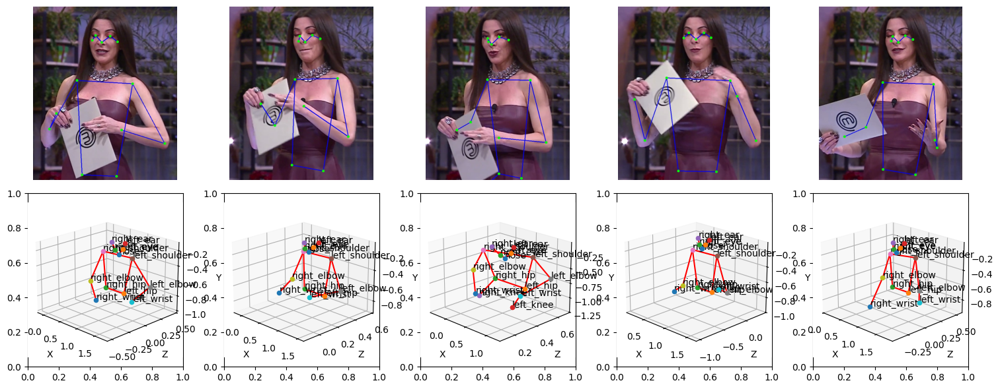
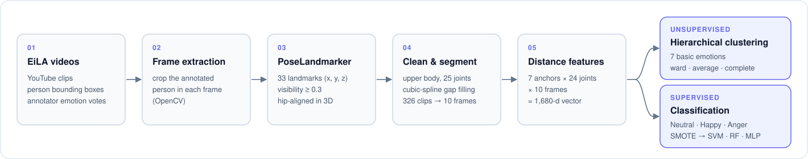

<p align="center">
  
  <br/>
  <sub>PoseLandmarker keypoints on consecutive EiLA frames (top) and the corresponding hip-aligned 3D skeletons (bottom).</sub>
</p>

<h1 align="center">PosEmotion</h1>

<p align="center">
  <b>Emotion Recognition from Skeletal Movements</b>
</p>

<p align="center">
  
  
  
  
  <a href="LICENSE"></a>
</p>

Facial expressions are easy to mask, so PosEmotion asks how much the body alone reveals. Using the Latin-American **EiLA** dataset, it turns every annotated clip into a sequence of 3D skeletons, describes the movement as a vector of joint-to-joint distances over time, and then answers two questions: do skeletal movements **cluster** into the seven basic emotions the annotators assigned, and how well can supervised models **classify** emotion from movement alone?

## Overview

- **Pose from video.** The annotated person is cropped from each frame and passed to MediaPipe **PoseLandmarker**, which returns 33 landmarks with estimated depth. Low-visibility joints (< 0.3) are dropped and each skeleton is rotated so the hips face the camera.
- **Clean, upper-body skeletons.** Legs are discarded, leaving 25 joints of the head, torso and arms. Frames with no upper-body detections are removed, and remaining gaps are filled with cubic splines.
- **Fixed-length segments.** Each *(video, clip, person)* triple is one segment labelled by the majority annotator vote. All 326 segments are resampled to 10 evenly spaced frames.
- **Movement features.** For 7 anchor joints (nose, shoulders, elbows, wrists), the Euclidean distance to every other joint is taken in each frame: 7 × 24 × 10 = **1,680 features** per segment.
- **Clustering and classification.** Agglomerative clustering tests whether the features recover the 7 emotion labels. SVM, Random Forest and an MLP are then trained on the three best-represented classes (**Neutral**, **Happy**, **Anger**) with SMOTE oversampling.

<p align="center">
  
</p>

<p align="center"><sub><b>Figure 1.</b> The PosEmotion pipeline, from video clips to emotion clusters and classifiers.</sub></p>

## Results

**Classification** (Neutral / Happy / Anger), mean ± std over 100 stratified 85/15 splits with SMOTE on the training set. F1 is weighted.

| Model | Accuracy | F1-score |
|---|:---:|:---:|
| SVM | **0.5816 ± 0.0310** | 0.4672 ± 0.0448 |
| Random Forest | 0.5539 ± 0.0563 | **0.5114 ± 0.0608** |
| Neural Network (MLP) | 0.4916 ± 0.0758 | 0.4174 ± 0.0300 † |

<sub>† Computed from the SVM predictions because of a bug in the notebook, which is now fixed. Re-run the MLP distribution cell to update this value.</sub>

SVM reaches the highest accuracy but struggles with the minority classes. Random Forest is the most balanced model, with the best F1-score.

<details>
<summary><b>Clustering</b> (agglomerative, Euclidean, all 7 emotions)</summary>

<br/>

| Linkage | Clusters | Silhouette ↑ | Davies–Bouldin ↓ |
|---|:---:|:---:|:---:|
| ward | 7 | 0.1507 | 1.5080 |
| ward | 5 | 0.1663 | 1.4382 |
| ward | 3 | 0.1603 | 1.5024 |
| **average** | **7** | **0.5648** | **0.5397** |
| average | 5 | 0.6225 | 0.6528 |
| average | 3 | 0.7240 | 0.1723 |
| complete | 7 | 0.5137 | 0.9460 |
| complete | 5 | 0.5270 | 0.9960 |
| complete | 3 | 0.7309 | 0.8466 |

Average linkage separates the seven emotions best. Qualitative inspection still shows strong overlap between emotions and ambiguity in the labels themselves.

</details>

## Quick start

Requires Python 3.9–3.12 and access to the EiLA dataset.

```bash
# 1. Install
python3.11 -m venv .venv && source .venv/bin/activate
pip install -r requirements.txt

# 2. Download the PoseLandmarker (Full) model
mkdir -p models
curl -L -o models/pose_landmarker_full.task \
    https://storage.googleapis.com/mediapipe-models/pose_landmarker/pose_landmarker_full/float16/latest/pose_landmarker_full.task

# 3. Put the EiLA videos and annotations under assets/ (see "Data preparation")

# 4. Run the notebook
pip install jupyterlab
jupyter lab posemotion.ipynb
```

## Notebook walkthrough

[`posemotion.ipynb`](posemotion.ipynb) runs the whole study in four steps:

| Step | What happens |
|---|---|
| 1. Preprocessing | Load annotations, extract frames, detect skeletons, clean and interpolate |
| 2. Feature extraction | Segment by *(video, clip, person)*, resample to 10 frames, count emotion votes |
| 3. Clustering | Distance features → agglomerative clustering, dendrogram and PCA plots |
| 4. Classification | SMOTE + grid-searched SVM, Random Forest and MLP, with confusion matrices and score distributions over 100 splits |

The expensive cells (frame extraction, augmentation and keypoint detection) start with `%%script True` so they are skipped by default. Comment out that line to run them the first time. Their outputs are cached under `assets/`.

## Details

<details>
<summary><b>Data preparation</b></summary>

<br/>

The project expects the EiLA dataset in `assets/` and the pose model in `models/` (both are git-ignored):

```
PosEmotion/
├── assets/
│   ├── annotations/
│   │   ├── annotations.csv        # EiLA labels and bounding boxes
│   │   └── keypoints_plm.csv      # written by the keypoint step
│   ├── videos/
│   │   ├── aJKL0ahn1Dk.mp4
│   │   └── ...
│   └── frames/                    # written by the frame-extraction step
│       ├── aJKL0ahn1Dk_0.jpg
│       └── ...
└── models/
    └── pose_landmarker_full.task
```

Each row of `annotations.csv` describes one annotated frame:

| Column | Meaning |
|---|---|
| `Video Tag` | YouTube ID of the source video (`videos/<tag>.mp4`) |
| `Clip Id` | Clip within the video |
| `Person Id` | Person within the clip |
| `Frame Number` | Annotated frame |
| `X`, `Y`, `Width`, `Height` | Person bounding box, as % of the frame size |
| `Labels` | One list of emotions per annotator, e.g. `[['Happy'], ['Happy'], ['Neutral']]` |

Frames are saved as `<Video Tag>_<row index>.jpg`, cropped to the bounding box.

</details>

<details>
<summary><b>Pipeline configuration</b></summary>

<br/>

| Stage | Setting |
|---|---|
| Pose model | [PoseLandmarker (Full)](https://ai.google.dev/edge/mediapipe/solutions/vision/pose_landmarker), 256 px input, 33 landmarks, normalised x, y + estimated depth z |
| Detection | visibility threshold 0.3, hip-based alignment via Rodrigues' rotation |
| Cleaning | landmarks 0–24 (nose to hips), drop frames with no body joints, cubic `UnivariateSpline` interpolation |
| Segments | 326 segments, resampled to 10 frames; label = most frequent annotator vote |
| Features | distances from 7 anchors (nose, L/R shoulder, L/R elbow, L/R wrist) to the other 24 joints, per frame → 1,680-d |
| Clustering | `AgglomerativeClustering`, Euclidean, ward / average / complete, k ∈ {3, 5, 7}, standardised features |
| Classes | Neutral (161), Happy (87), Anger (42); Sad, Surprise, Disgust and Fear (< 12 each) are removed |
| Split | stratified 85/15, SMOTE on the training split only |
| SVM | `class_weight="balanced"`; grid over C, γ and kernel (linear, rbf, sigmoid, poly) |
| Random Forest | grid over `n_estimators`, `max_depth`, `min_samples_split`, `min_samples_leaf` |
| MLP | Dense 64 → Dropout → Dense 35 → softmax, L2; grid over L2, dropout, optimiser, epochs, batch size; early stopping |

</details>

<details>
<summary><b>Data augmentation</b></summary>

<br/>

`Extractor` can enlarge the frame set with vertical and horizontal flips and random rotations. It was not used for the reported results.

```python
from tools.extractor import Extractor

extractor = Extractor("assets/annotations/annotations.csv", "assets/videos", "assets/frames")
extractor.extract_frames()
extractor.flip_frames(target="assets/frames_vflip", axis=0)
extractor.flip_frames(target="assets/frames_hflip", axis=1)
extractor.random_rotate_frames(target="assets/frames_rotated", minr=30, maxr=330)
```

</details>

<details>
<summary><b>Using the tools directly</b></summary>

<br/>

```python
from tools.detector import PoseLandmarkerDetector
import tools.davinci as dv

detector = PoseLandmarkerDetector("models/pose_landmarker_full.task")
skeleton = detector.detect("assets/frames/aJKL0ahn1Dk_0.jpg", align=True)

jpg_bytes = dv.draw(skeleton)   # 2D overlay on the frame (JPEG bytes)
ax = dv.visualize(skeleton)     # 3D matplotlib plot
```

</details>

<details>
<summary><b>Repository layout</b></summary>

<br/>

```
PosEmotion/
├── media/               # README figures
├── tools/
│   ├── extractor.py     # Frame extraction and augmentation from annotated videos
│   ├── detector.py      # PoseLandmarker wrapper and skeleton alignment
│   ├── structures.py    # Skeleton and Segment classes, distance features
│   ├── metrics.py       # Segmentation, resampling and spline interpolation
│   └── davinci.py       # 2D and 3D skeleton visualisation
├── posemotion.ipynb     # End-to-end study
└── requirements.txt
```

</details>

## Citation

```bibtex
@software{krylov2024posemotion,
  author      = {Denis Krylov},
  title       = {{PosEmotion}: Emotion Recognition from Skeletal Movements},
  year        = {2024},
  institution = {University of Twente},
  url         = {https://github.com/denskrlv/PosEmotion}
}
```

## License

Released under the [Apache License 2.0](LICENSE).
